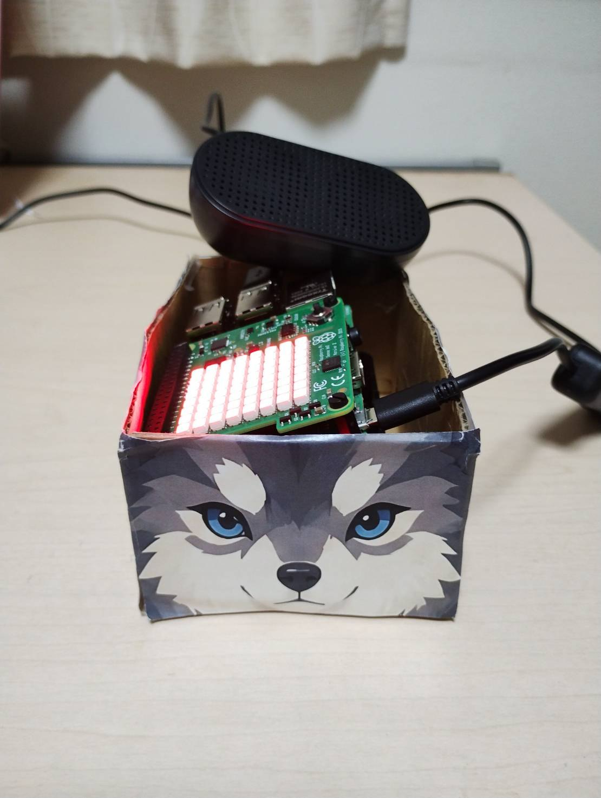
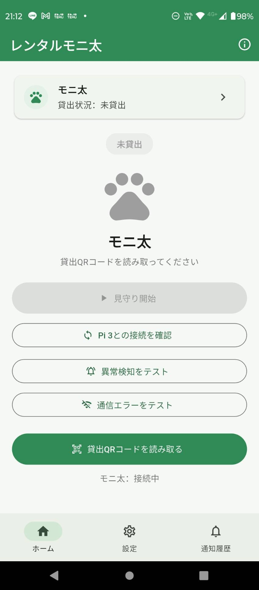
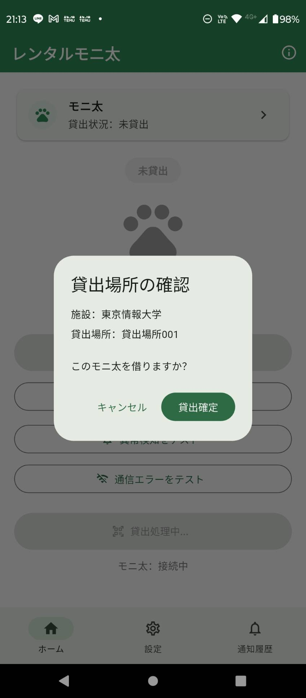
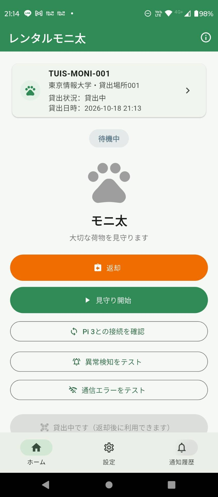
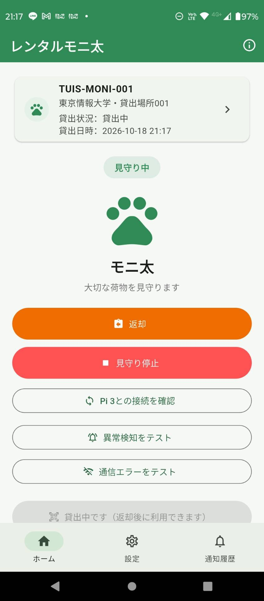
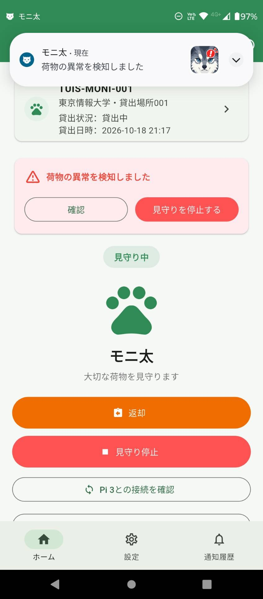
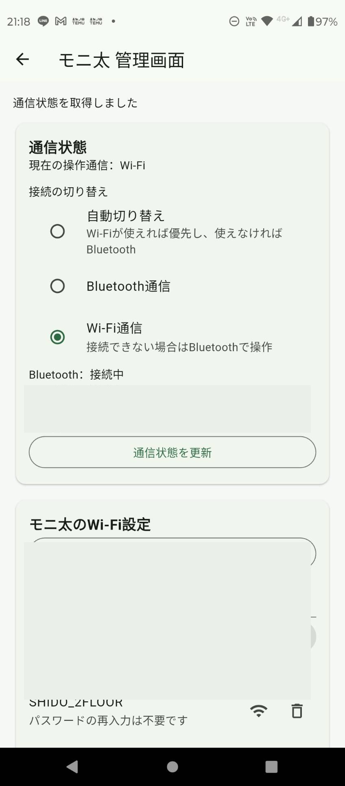
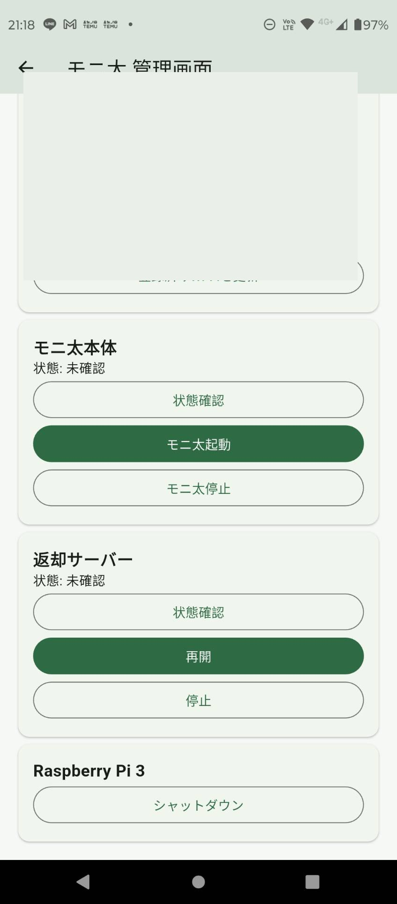
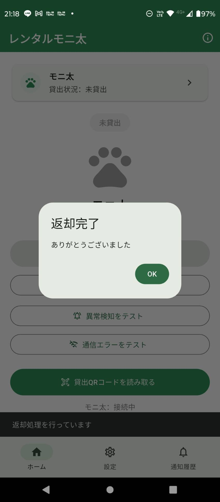

# モニ太（Rental Monita）

**Raspberry Piを活用した持ち物の盗難防止システム**  |  大学でのチーム研究・開発中（2026年10月現在）



## 概要・開発目的

大学や図書館などの施設で短時間席を離れる際、持ち物の盗難リスクを軽減することを目的に、Raspberry Piとセンサーを活用した盗難防止システム「モニ太」を開発しています。

持ち物の動きをセンサーで検知し、異常時にはAndroidアプリへ通知します。施設での貸出を想定し、スマートフォンから貸出・見守り・返却まで操作できる仕組みを目指しています。

## 自分の担当

- Raspberry Pi 3の設定・動作制御
- センサーによる異常検知機能
- Bluetooth・Wi-Fiによる通信機能
- FlutterアプリのUI設計・実装
- 管理者向け機能の実装
- チーム内の進捗管理

※大学でのチーム制作のため、本リポジトリに含まれるコードのすべてを個人で制作したものではありません。

## 使用技術

- **Flutter / Dart**：Android向け利用者アプリ・返却用アプリ
- **Python / Raspberry Pi 3 / Sense HAT**：本体制御・センサー監視・状態表示
- **Bluetooth Classic**：Raspberry PiとAndroidアプリの通信
- **Wi-Fi / WebSocket**：ネットワーク経由の通信
- **Firebase Cloud Messaging / flutter_local_notifications**：通知関連機能

## 主な機能

- QRコードによる貸出手続き
- 見守りの開始・停止
- センサーによる持ち物の異常検知
- 異常検知時のアプリ画面表示・Android通知
- Bluetooth・Wi-Fiによる通信
- 貸出・見守り状態の表示と操作履歴の記録
- アプリからの返却処理
- 管理者向けの本体操作・通信設定機能

## 画面・動作例

### 1. 貸出前のホーム画面



### 2. QRコード読み取り後の貸出確認



### 3. 貸出後の待機画面



### 4. 見守り中



### 5. 異常検知とAndroid通知



### 6. 管理者向け画面

Bluetooth・Wi-Fiの通信状態や本体の操作機能を確認できます。画面中のネットワーク識別情報は公開用に伏せています。





### 7. 返却完了



## 工夫した点

- **複数の通信手段**：BluetoothとWi-Fiの通信経路を用意し、通信環境に応じた接続方法を検討
- **異常の可視化**：センサーの検知結果をアプリの警告表示とAndroid通知につなぐ
- **分かりやすい操作画面**：貸出・見守り・返却の状態を確認しやすいUIを設計
- **運用を意識した管理機能**：接続状態や本体の動作を管理画面から確認・操作
- **チームでの開発**：作業内容や進捗を整理し、メンバー間で共有

## Raspberry Pi実機との連携

Raspberry Pi 3とAndroidスマートフォンを使用し、実機での動作確認を行っています。UIのみのプロトタイプではなく、センサー監視や通信処理を組み合わせた開発を進めています。

`RaspberryPi/monita.py` を中心に、センサー監視、Sense HATの状態表示、Bluetooth Classic通信、WebSocket通信、貸出・見守り・返却状態の制御などを実装しています。

`RaspberryPi/admin_server.py` は管理機能、`RaspberryPi/return_server.py` は返却サーバー関連のコードです。`hardware/`、`monitoring/`、`communication/`、`system/` には機能別のモジュールを収録しています。

## 開発状況・今後の課題

- **2026年10月現在、開発・実機検証を継続中**です。
- QRコードによる貸出、見守り操作、異常検知と通知、アプリからの返却処理などを実装しています。
- 返却箱でのQRコード読み取りとサーバーによる返却確認は、今後の連携課題です。
- Bluetooth・Wi-Fiの接続安定性や、ネットワーク環境が変わった場合の通信について改善を進めています。

## フォルダー構成

```text
RentalMonita/
├── README.md
├── .gitignore
├── UserApp/
│   └── rental_monita_flutter/  # 利用者向けFlutterアプリ
├── ReturnApp/
│   └── monita_return_app/     # 返却用Flutterアプリ（開発中）
├── RaspberryPi/              # Pythonによる本体・センサー・管理機能
└── screenshots/              # アプリ画面・試作機の写真
```

## 実行環境・注意点

- Androidアプリの実行にはFlutter SDK、Android SDKなどの開発環境が必要です。
- Raspberry Pi側は対応ハードウェア、Pythonの依存パッケージ、Bluetooth・Wi-Fiの設定、必要な権限などを環境に応じて調整する必要があります。
- Firebase設定や端末固有の設定は公開用リポジトリに含めていないため、ビルド・実行時に追加設定が必要な場合があります。
- `sounds/` の音声ファイルは権利関係を確認するため公開対象から除外しています。

## 公開について

本プロジェクトは大学でのチーム制作物です。GitHubへのソースコードおよび関連資料の公開については、チームメンバーから許可を得ています。

